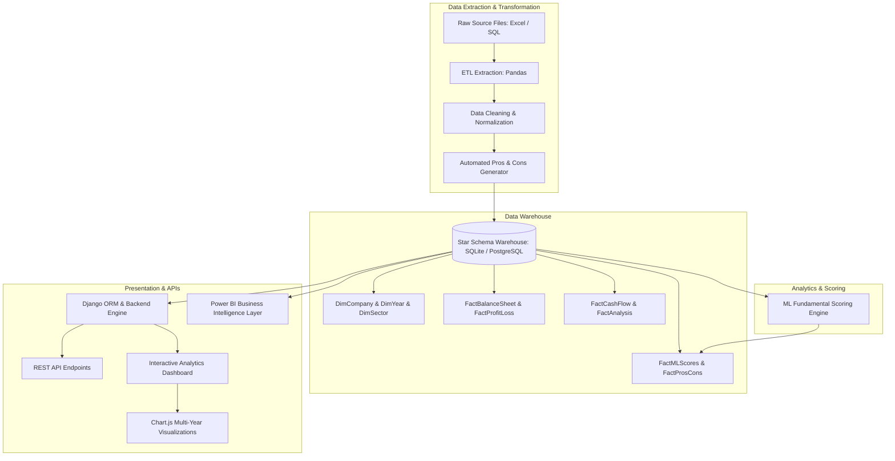

# Nifty 100 Fundamental Intelligence

An institutional-grade data engineering, fundamental analysis, and automated health-scoring platform for Nifty 100 listed companies. Built during the Data Analyst Internship at **Bluestock Fintech**.

**Author:** Karan Veer Singh Sikarwar  
**Role:** Data Analyst Intern  
**Organization:** Bluestock Fintech ([bluestock.in](https://bluestock.in))  

---

## Project Overview

B100 Intelligence is an end-to-end financial data pipeline and web application designed to eliminate the friction of analyzing raw, unstructured corporate filings. Indian listed companies report complex financial statements across disparate formats with differing accounting conventions, missing labels, and inconsistent period definitions.

This project ingests raw financial statement dumps, transforms and cleans the underlying metrics, models the data into an auditable Star Schema Data Warehouse, and computes autonomous 5-pillar fundamental health scores across 92 top listed Indian enterprises.



---

## About Bluestock Fintech

Bluestock Fintech is a modern Indian financial technology and stock market analytics platform. It focuses on retail investor education, real-time analytics, IPO tracking, community-driven trading tools, and charter learning programs.

During the Data Analyst Internship, this project addressed core financial data modeling requirements:
1. Converting raw, heterogeneous corporate reporting files into a clean relational warehouse.
2. Formulating objective, metrics-backed fundamental health algorithms.
3. Generating qualitative strengths and vulnerabilities for every stock using quantitative thresholds.
4. Exposing dynamic API feeds and interactive web interfaces for retail analysts.

---

## Data Warehouse Architecture (Star Schema)

The platform implements a dimensional Star Schema database model to optimize query performance and ensure auditability across multi-year statements:

### Dimension Tables
- **`dim_company`**: Ticker symbol (Primary Key), registered company name, sector classification, sub-sector, official website, NSE profile URL, BSE profile URL, face value, and business description.
- **`dim_year`**: Fiscal year identifier, descriptive year label, fiscal year integer, quarter tag, TTM (Trailing Twelve Months) flag, and sequential sort order.
- **`dim_sector`**: Unique sector code, sector display name, and descriptive operational categorization.
- **`dim_health_label`**: Categorical classification labels (EXCELLENT, GOOD, AVERAGE, WEAK, POOR) mapped to score bands and hexadecimal interface colors.

### Fact Tables
- **`fact_balance_sheet`**: Equity share capital, retained reserves, long-term borrowings, other liabilities, total balance sheet liabilities, fixed assets, capital work-in-progress (CWIP), investments, total assets, debt-to-equity ratio, equity ratio, book value per share, asset turnover ratio, and return on assets (ROA).
- **`fact_profit_loss`**: Gross sales revenue, operating expenses, operating profit, operating profit margin (OPM %), other income, financing interest costs, depreciation and amortization, profit before tax (PBT), effective tax rate, net profit, earnings per share (EPS), dividend payout ratio, net profit margin %, expense ratio, and interest coverage ratio.
- **`fact_cash_flow`**: Operating cash flow, investing cash flow, financing cash flow, net cash flow, free cash flow (FCF), and cash conversion ratio (CCR).
- **`fact_analysis`**: 3-Year, 5-Year, and 10-Year compounded sales growth CAGR, compounded profit growth CAGR, stock price CAGR, and Return on Equity (ROE %).
- **`fact_ml_scores`**: Composite overall health score, individual pillar breakdown scores (profitability, growth, leverage, cash flow, dividend, and trend momentum), timestamp of computation, and categorical health label.
- **`fact_pros_cons`**: Structured investment strengths (pros) and risk factors (cons) dynamically generated from warehouse ratios and sectoral moats.

---

## Fundamental Health Scoring Engine Methodology

Every listed company is evaluated on a rigorous 0 to 100 point scale. The system combines five distinct fundamental dimensions using audited financial statements:

$$\text{Overall Health Score} = (\text{Profitability} \times 25\%) + (\text{Growth} \times 25\%) + (\text{Leverage} \times 20\%) + (\text{Cash Flow} \times 15\%) + (\text{Trend} \times 15\%)$$

### 1. Profitability Pillar (25% Weight)
Measures operating capital efficiency and net profit pricing power:
- **Return on Equity (ROE %):** How effectively equity capital is deployed.
- **Net Profit Margin (NPM %):** The percentage of gross sales converted into bottom-line profits.
- **Calculation:**  
  $$\text{Profitability Score} = \text{Clip}\left((\text{ROE} \times 2) + (\text{NPM} \times 2),\, 0,\, 100\right)$$

### 2. Growth and Compounding Pillar (25% Weight)
Assesses multi-year revenue and net profit momentum:
- Evaluates 3-Year Compounded Sales CAGR and 3-Year Compounded Profit CAGR.
- **Zombie Company Penalty:** If 3-Year Sales CAGR is below 5%, the maximum growth score is strictly capped at $\min(20, \text{Sales CAGR} \times 4)$. This penalizes stagnant legacy enterprises that fail to beat core inflation.
- **Calculation (Normal):**  
  $$\text{Growth Score} = \text{Clip}\left((\text{Sales CAGR} \times 3) + (\text{Profit CAGR} \times 2),\, 0,\, 100\right)$$

### 3. Leverage and Solvency Safety Pillar (20% Weight)
Evaluates financial gearing and balance sheet buffer against rising interest rates:
- Starts from a pristine baseline score of **100 points**:
  - **Debt-to-Equity (D/E):** Deducts 50 points if $\text{D/E} > 2.0$; deducts 25 points if $\text{D/E} > 1.0$.
  - **Interest Coverage Ratio (IC):** Deducts 50 points if $\text{IC} < 1.0$; deducts 20 points if $\text{IC} < 3.0$.
- Protects investors against highly leveraged companies vulnerable to debt distress.

### 4. Cash Flow Quality Pillar (15% Weight)
Distinguishes real liquid cash generation from accounting accrual profits:
- Starts from a baseline score of **50 points**:
  - **Free Cash Flow (FCF = Operating Cash Flow + Investing Cash Flow):** Awards +25 points if $\text{FCF} > 0$.
  - **Cash Conversion Ratio (CCR = Operating Cash Flow / Net Profit):** Awards +25 points if $\text{CCR} > 0.8$.
- Maximum score: 100 points.

### 5. Historical Trend Momentum Pillar (15% Weight)
Compares the Trailing Twelve Months (TTM) Net Profit against the 3-Year historical average to detect turnaround or operational deceleration:
- **Trend Ratio:**  
  $$\text{Trend Ratio} = \frac{\text{Latest TTM Profit} - \text{3-Year Average Profit}}{|\text{3-Year Average Profit}|}$$
- **Calculation:**  
  $$\text{Trend Score} = \text{Clip}\left(50 + (\text{Trend Ratio} \times 100),\, 0,\, 100\right)$$

### Health Classification Bands
| Health Label | Score Range | Investment Profile |
| :--- | :---: | :--- |
| **EXCELLENT** | 80 to 100 | Pristine balance sheet, negligible debt, superior ROE, robust free cash flows |
| **GOOD** | 60 to 79.9 | Healthy operational performance with minor margin or growth constraints |
| **AVERAGE** | 40 to 59.9 | Moderate fundamentals with balanced risk-reward profile |
| **WEAK** | 20 to 39.9 | Elevated leverage, thinning margins, or negative free cash flows |
| **POOR** | 0 to 19.9 | Distressed capital structure, persistent losses, or severe interest stress |

---

## Automated Fundamental Pros and Cons Engine

To provide qualitative investment insights alongside quantitative scores, the platform includes a rules-based fundamental engine (`etl/generate_pros_cons.py`). 

The engine cross-examines warehouse statements for all 92 companies to generate **540 curated pros and cons**:
- **Solvency Checks:** Virtuality debt-free status, low D/E ratios, and safe interest coverage.
- **Margin Analysis:** High net profit margins, operating margin resilience, and pricing power.
- **Cash Flow Health:** Positive free cash flow generation and cash conversion efficiency.
- **Sector Moats:** Custom qualitative industry advantages for IT, Banking, FMCG, Auto, Energy, Healthcare, Metals, Retail, and Infrastructure.
- **Risk Identification:** High leverage warnings, low interest coverage, margin deceleration, negative free cash flows, and cyclical commodity exposures.

---

## Technology Stack

- **Data Engineering:** Python 3.11, Pandas, NumPy, SQLAlchemy
- **Data Warehousing:** SQLite 3 (Standalone local mode) / PostgreSQL 15 (Docker container mode)
- **Web Backend:** Django 5.2, Django REST Framework (DRF), django-filter
- **Frontend Layer:** Bootstrap 5, Chart.js 4, Bootstrap Icons
- **Task Orchestration:** Celery 5, Redis 7 (Docker mode)
- **BI & Analytics:** Power BI Desktop, DAX data modeling

---

## Quick Start and Setup Instructions

### Option 1: Standalone Local Mode (Recommended, No Docker Required)

This repository includes a standalone local runner that requires no Docker Desktop, no external PostgreSQL service, and no Redis service.

1. Clone the repository:
   ```cmd
   git clone https://github.com/karanveersingh05/Nifty-100-Fundamental-Intelligence.git
   cd Nifty-100-Fundamental-Intelligence
   ```

2. Run the application:
   Double-click `run_without_docker.bat` (or `run_local.bat`).

   **What the script does automatically:**
   - Detects the Python interpreter (virtual environment or system Python).
   - Sets the database to the local SQLite warehouse (`data/b100_local.sqlite3`) and cache to in-memory.
   - Automatically executes database migrations.
   - On initial launch, runs the full ETL pipeline (extracting Excel data, cleaning metrics, populating the warehouse) and calculates ML scores.
   - Automatically opens your default browser at `http://127.0.0.1:8000`.

---

### Option 2: Docker Container Deployment

If you prefer to run the containerized multi-service ecosystem (PostgreSQL 15, Redis 7, Celery Worker, Celery Beat, and Django):

1. Make sure Docker Desktop is running.
2. Double-click `run_project.bat` or run:
   ```bash
   docker-compose up -d --build
   ```
3. Populate the warehouse and run scoring inside the container:
   ```bash
   docker-compose exec web python etl/01_extract_from_mysql.py
   docker-compose exec web python etl/02_clean_and_transform.py
   docker-compose exec web python etl/03_load_to_warehouse.py
   docker-compose exec web python analytics/scoring_engine.py
   ```
4. Access the web dashboard at `http://localhost:8000`.

---

### Option 3: Manual Command Line Setup

```bash
# 1. Create and activate a virtual environment
python -m venv venv
venv\Scripts\activate   # On Windows
# source venv/bin/activate  # On Linux / macOS

# 2. Install required dependencies
pip install -r requirements.txt

# 3. Set local mode environment variable
set USE_SQLITE=1        # On Windows (cmd)
# export USE_SQLITE=1   # On Linux / macOS / bash

# 4. Run migrations
python webapp/manage.py migrate

# 5. Execute ETL Pipeline and Scoring Engine
python etl/01_extract_from_mysql.py
python etl/02_clean_and_transform.py
python etl/03_load_to_warehouse.py
python analytics/scoring_engine.py

# 6. Start the development server
python webapp/manage.py runserver 127.0.0.1:8000
```

---

## Key Dashboard Routes

- **Leaderboard:** `http://127.0.0.1:8000/`  
  Live search across 92 companies, overall health score rankings, and interactive scoring methodology modal.
- **Company Detail Report:** `http://127.0.0.1:8000/company/<SYMBOL>/`  
  Individual stock breakdown featuring 8 interactive financial charts (Revenue and Profit trends, Balance Sheet composition, Cash Flow waterfall, EPS and Dividend history, Debt vs Equity stacked bars, Growth radar, and Margins), individual pillar scorecards, and curated Pros and Cons.
- **Company Directory:** `http://127.0.0.1:8000/companies/`  
  Searchable directory of all constituent stocks categorized by sector.
- **Side-by-Side Comparator:** `http://127.0.0.1:8000/compare/`  
  Add up to 4 ticker symbols simultaneously for side-by-side metric comparison.
- **Stock Screener:** `http://127.0.0.1:8000/screener/`  
  Filter stocks by sector and minimum composite health score threshold.

---

## Auditing and Verification

To verify that the dashboard numbers match the underlying warehouse data:

```bash
python powerbi_verification.py
```

This script executes ground-truth verification queries directly against the database, printing audited metrics for cross-referencing with Power BI dashboards and financial reports.

---

## Repository Structure

```
├── analytics/
│   ├── notebooks/               # Jupyter research and exploratory analysis
│   └── scoring_engine.py        # 5-Pillar fundamental scoring algorithm
├── core/
│   ├── db.py                    # Dual-engine database connection (SQLite / Postgres)
│   └── models.py                # SQLAlchemy Star Schema ORM models
├── data/
│   ├── clean/                   # Cleaned CSV files (analysis, balance sheet, p&l, pros/cons)
│   ├── raw/                     # Intermediary raw CSV extraction
│   └── source_files/            # Original source Excel files (analysis, balance sheet, etc.)
├── etl/
│   ├── 01_extract_from_mysql.py # Ingestion from Excel / SQL dumps
│   ├── 02_clean_and_transform.py# Cleaning, regex parsing, and financial ratio derivation
│   ├── 03_load_to_warehouse.py  # Upserting data into relational warehouse tables
│   └── generate_pros_cons.py    # Automated fundamental pros and cons generator
├── orchestration/
│   ├── celery_app.py            # Celery task configuration and beat schedules
│   └── tasks.py                 # Async background pipeline tasks
├── webapp/
│   ├── b100_core/               # Django project settings and URLs
│   ├── companies/               # Company models, views, and REST API endpoints
│   ├── dashboard/               # Frontend templates, views, and routing
│   └── manage.py                # Django CLI management utility
├── b100_dashboards.pbix         # Power BI interactive reporting file
├── docker-compose.yml           # Container specification (Web, Postgres, Redis, Celery)
├── Dockerfile                   # Python container image definition
├── requirements.txt             # Project dependencies
├── run_local.bat                # 1-Click Windows standalone local launcher
├── run_project.bat              # Docker deployment launcher with local fallback
└── run_without_docker.bat       # Standalone local launcher (SQLite + memory cache)
```

---

## License

This project is licensed under the MIT License. See the [LICENSE](LICENSE) file for full details.

---

## Author and Acknowledgements

- **Author:** Karan Veer Singh Sikarwar
- **Project:** Nifty 100 Fundamental Intelligence (B100 Intelligence)
- **Internship:** Data Analyst Internship at **Bluestock Fintech**
